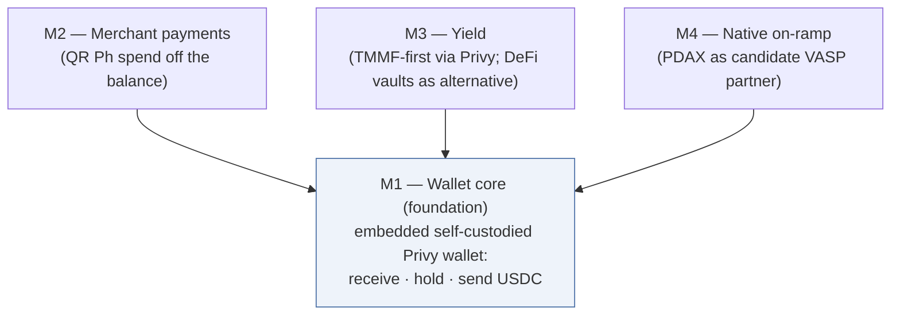
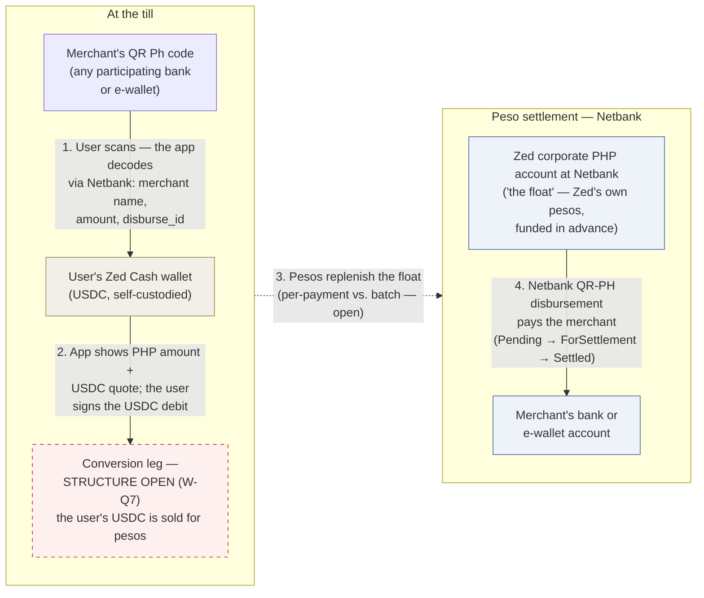
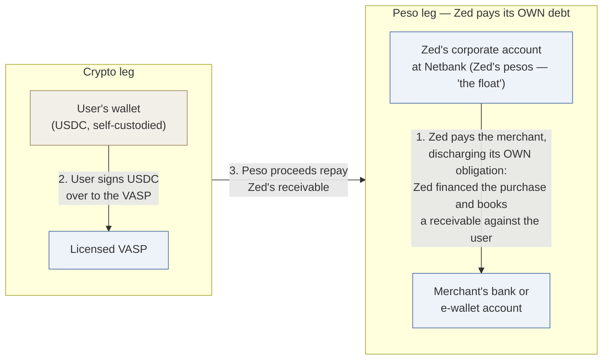
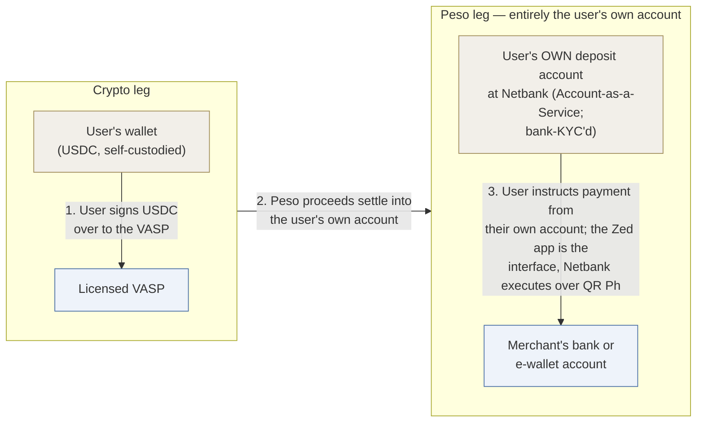

# Zed Dollar Wallet — Modular PRD (wallet-first)

**Status:** Draft v0.3 (2026-11-17) — settled facts only; decisions marked `OPEN` are for joint resolution (none silently assumed). Standalone product proposal.
**Surfaces:** repo canonical: this file; collaborative working copy: Claude Doc; team copies: Word files in Drive under Shared drives/Product/USDC Accounts (refreshed on meaningful revisions). Team copies carry no internal-workflow language.
**IDs:** decisions `W-D*`, requirements `W-R*`, open questions `W-Q*`; Privy confirmations use the shared `C-PR*`/`C-Q*` IDs (canonical in the counterparty tracker).

---

## 1. Summary

Zed offers Philippine customers a dollar-denominated account holding **USDC** in a **genuinely user-owned, self-custodied Privy wallet**, embedded as a tab in the existing Zed app. Unlike the previous architecture — which stood or fell with a single on-ramp partner — this product is built **wallet-first, in modules**: the wallet core ships without any money-movement partner at all (users fund it from wherever they already can), and merchant payments, yield, and a native on-ramp bolt on later, each as a product that can stand alone.

**Why the pivot:** the previous architecture routed its entire deposit leg through Coins.ph's inbound InstaPay/PESONet rails — exactly the capability the Bangko Sentral ng Pilipinas (BSP) suspended on 2026-09-29, with reinstatement timing unknown and the alleged abuse pattern (third parties settling with offshore-gaming operators in stablecoins) uncomfortably close in shape to a merchant pass-through on-ramp. The lesson is structural, not tactical: **no single counterparty should be able to take the whole product down.** The wallet core requires no licensed money-movement partner; every module that does require one is isolated, swappable, and optional.

### 1.1 The module map

| Module | One-line product | Stands alone as | Needs a licensed money-movement partner? |
|---|---|---|---|
| **M1 — Wallet core** | An embedded, self-custodied USDC wallet: your own address to receive, hold, send | A dollar store-of-value for anyone who can already acquire USDC | **No** — pure wallet software; funding is bring-your-own on-ramp |
| **M2 — Merchant payments** | Pay any QR Ph merchant from the USDC balance | "Spend dollars anywhere QR Ph works" | Yes — **Netbank** settles the PHP leg via its QR-PH disbursement API (decided 11/17); the USDC→PHP conversion leg is the open question (W-Q7) |
| **M3 — Yield** | Opt-in yield on held USDC — tokenized money market funds (TMMFs) first, decentralized-finance (DeFi) lending vaults as the alternative | A dollar savings product | No money-movement partner; instrument/venue gates instead (SRC §8 for TMMFs — design-blocking) |
| **M4 — Native on-ramp** | PHP in → USDC lands in the user's wallet | The convenience layer that completes the loop | Yes — a VASP partner; **PDAX** (Philippine Digital Asset Exchange) is the candidate; a complete partner-integration + ledger design template exists (document map, §5) |

**Build order:** M1 first — it is the only hard prerequisite; everything else bolts onto it. M2, M3, M4 are mutually independent and sequence by opportunity (current lean: M2, then M3 with TMMF-first, then M4). Priority and pilot scope per module → W-D8.

**Positioning:** "preserve wealth" over "grow savings" (peso-depreciation framing); never present yield in isolation; design for the stablecoin-literacy gap. The M1-only product targets users who can already self-fund — crypto-aware early adopters among the existing cardholder base — and that cohort choice is a feature: it validates custody UX and demand before any partner dependency exists.

## 2. Decisions

### 2.1 Settled

| # | Decision | Choice | Basis |
|---|---|---|---|
| W-D1 | Strategy | **Wallet-first, modular** (Steve, 11/12): M1 ships with bring-your-own funding; M2/M3/M4 are isolated bolt-ons, each viable alone | BSP suspension of Coins.ph inbound rails demonstrated the single-partner failure mode |
| W-D2 | Custody | User-owned, self-custodied Privy wallet; no Zed signer or keys; open-loop; all outbound user-signed | No-unilateral-Zed-signing posture; Privy configuration confirmations C-PR-1..5 apply |
| W-D3 | Stablecoin | USDC | Privy Earn USDC vaults are live self-serve; Circle issuer posture |
| W-D4 | Surface | **Standalone app (decided 11/17)** — shipped as a mobile progressive web app (PWA) for the pilot; native packaging later if warranted | 11/17 meeting — reverses the earlier in-app-tab lean: the product targets a cohort up to 10× the cardholder base and stands on its own brand; a PWA keeps iteration outside app-store review |
| W-D5 | M3 instrument order | **TMMF first**, DeFi lending vaults (Aave-family via Privy) as the alternative | Steve, 11/12; easier regulator story, countercyclical, Treasury-backed; subject to the SRC §8 gate |
| W-D6 | M1 funding model | **Bring-your-own on-ramp**: the user funds their own address from any external source; Zed builds no deposit rail into M1 | Steve, 11/12 — the de-risking core of the strategy |
| W-D7 | M2 PHP settlement partner | **Netbank (decided 11/17)**: QR Ph decode + disbursement from a prefunded Zed corporate account, via its QR-PH API (`research/netbank-qrph.md`) | 11/17 meeting; Zed has an existing Netbank relationship (items C-NB-1..7 in the Counterparty & Counsel Tracker). Covers the payout leg only — the conversion leg is W-Q7 |

### 2.2 OPEN

| # | Decision | The question | Preliminary note |
|---|---|---|---|
| W-D8 | Module sequencing + pilot scope per module | Current lean M2 → M3 → M4; cohort + caps per module undecided | Prior working reference for M1: ~50 invite-only existing cardholders, conservative caps |
| W-D9 | Naming / brand | Current working name: **"Zed Cash"** (11/16); final naming open | Steve's call + a compliance floor on USDC/Circle disclosure prominence |
| W-D10 | Chain | Lean: Base (Privy Earn USDC vaults live there) — but now gated on M3 instrument availability and M2/M4 partner rails | Chain follows the instruments and the partner rails |
| W-D11 | M1 receive guardrails | How open is "open-loop receive": any sender vs. screening/limits; multi-chain receive vs. single-chain with guidance | Interacts with W-Q3 (counsel) |

## 3. Module requirements

Each module: the flow to build first, then requirements as capability statements with implementation detail nested beneath.

### M1 — Wallet core (the foundation)

**The flow to build:** an existing Zed cardholder activates the Dollar Wallet tab; their self-custodied Privy wallet is created (user-sole-owner, keyed to Zed's existing auth via JSON Web Token / OpenID Connect bring-your-own-auth — no re-registration); they see their **receive address** with clear chain guidance and can share/copy it; funds they send from an exchange or another wallet appear as their USDC balance; they can **send** USDC to any address by signing the transaction themselves; everything keeps working regardless of their card-account state.

- **W-R1. Wallet creation.** User-sole-owner Privy wallet; no Zed key material; export/recovery usable independently of Zed (C-PR-3); creation idempotent and invisible-fast inside the tab.
- **W-R2. Receive.** The address is first-class UX: copy/share/QR render, explicit chain labeling ("send only USDC on {chain}"), deposit detection with confirmation states, and a designed answer for wrong-asset/wrong-chain sends (recovery guidance, not silence). Chain scope per W-D10/W-D11.
- **W-R3. Send.** User-signed, open-loop to any address; fee (gas) handling defined (sponsored vs. user-paid → gas strategy from the Privy tech digest); address-book and safety affordances (test-send nudge, allowlist option).
- **W-R4. Balance truth.** The chain is the source of truth; no Zed ledger of user balances. Display = on-chain balance + pending in/outbound states.
- **W-R5. Card-account-state independence.** Delinquency locks the card tab, never the wallet; closed card accounts retain wallet access (empty/marketing-state pattern); forced-offboarding path designed without a partner to force it through.
- **W-R6. Compliance posture** (→ W-Q3): Zed provides self-custody wallet software; it is not custodian, exchange, or transmitter. Product must preserve that: no pooling, no Zed-controlled flow of user funds, terminology discipline. Sanctions/screening posture on receive and send per counsel.
- **W-R7. Runbooks.** Privy outage, chain congestion, compromised-device support flow, pilot halt (which, with no partner, is just feature-flagging the tab).

### M2 — Merchant payments (QR Ph, settled via Netbank)

The user pays from a dollar balance; the merchant receives ordinary pesos over the QR Ph rails they already accept, and never needs to know crypto was involved. Making that work means every payment has two legs: a **conversion leg** (the user's USDC becomes pesos) and a **settlement leg** (pesos reach the merchant's bank). Netbank owns the settlement leg. Who owns the conversion leg is the module's open question (W-Q7).

**The flow to build:** the user scans any QR Ph code (the Philippines' national QR payment standard); the app decodes it through Netbank (`GET /v1/qrph/decode` — merchant name and city, PHP amount for dynamic codes, person-to-merchant vs person-to-person type, and a `disburse_id`); the app shows the merchant and PHP amount and quotes the USDC debit (rate disclosed at the moment of confirmation); the user confirms with their signature; the PHP leg settles via Netbank's QR-PH disbursement (`POST /v1/qrph/transactions`), which debits a prefunded Zed corporate account at Netbank and pays the beneficiary, tracked Pending → ForSettlement → Settled. API detail: `research/netbank-qrph.md`.

- **W-R8. Two legs, separately owned.**
  - The **settlement leg is Netbank's** (W-D7): Zed keeps a pool of its own pesos at Netbank, funded in advance (the "float"), and each merchant payment is disbursed from it.
  - The **conversion leg** — how the user's USDC turns into pesos that replenish that float — is the module's remaining design and counsel question (W-Q7). Two candidate structures, with a working lean:
    - **(a) VASP partner as conversion principal — the lean.** The user's signed USDC goes directly to a licensed VASP, which settles pesos to the Netbank float on its own cycle; the merchant is still paid instantly from the float. A VASP relationship exists for treasury anyway, so the swap likely rides the same counterparty.
    - **(b) Self-executed alternative — a viable path if (a) is not used.** Zed, as a licensed credit provider, finances the purchase (pays the merchant, books a peso receivable); the user settles the receivable by conveying USDC at a disclosed valuation (dación en pago — payment in kind under the Civil Code); Zed then liquidates its own USDC through a VASP on its own account. Each leg carries an established legal name; the reasoning method is §4.0’s. Costs: couples M2 to the lending entity; the dación valuation moment needs the most careful papering.
    - **(c) User-owned bank accounts (Netbank Account-as-a-Service) — a third option: no float, no credit.** Each user holds a deposit account at Netbank in their own name (bank KYC at onboarding); conversion proceeds settle into the user's own account; the QR payment is the user instructing their own bank, with the Zed app as the interface. Zed touches no funds at any step — the cleanest shape across the OPS, e-money, and custody questions (see the OPS analysis in §4.0). Its costs: per-user bank KYC friction and Netbank's appetite at scale; and either the conversion partner enters the at-the-counter critical path (per-payment conversion) or the product becomes two-step — the user pre-converts and spends from a peso balance in their own account. Capability and consent-mandate questions → W-Q8.
    - Cross-cutting structures (a) and (b): per-payment versus treasury-batch conversion decides who bears exchange-rate risk.
- **W-R9. Rate + total-cost disclosure** at confirmation; no spread opacity. Static QR codes carry no amount — the user enters it before quoting.
- **W-R10. Per-payment traceability.** Decode payload, our `reference_id`, Netbank `transaction_id` + status trail, quote, rate, USDC debit tx hash — reconcilable end to end.
- **W-R18. The payment must finish while the customer is standing at the counter.** A QR Ph payment happens in person: the merchant watches their screen for the confirmation before handing over the goods. So the whole chain — decode, quote, the user's signature, Netbank's disbursement, the merchant's confirmation — has to complete reliably in a few seconds, like a card tap; "usually fast" is a failed checkout. Two concrete consequences: Netbank's API supports an approval step designed for back-office payouts (a second employee approving each disbursement — "maker-checker"); that must be configured OFF the per-payment path, or every purchase would stall at the till (→ W-Q8). And the pilot may restrict to merchant codes (person-to-merchant) only, leaving person-to-person QR transfers out of scope.

### M3 — Yield

**The flow to build:** a separate, opt-in surface under its own terms: the user moves USDC from their wallet into the yield instrument by signing themselves, watches the position, withdraws anytime by signing again. **Instrument order: TMMF first** (W-D5), reachable through the same Privy integration; DeFi lending vaults (Aave-family) as the fallback if the TMMF gate fails.

- **W-R11. The SRC §8 gate comes before design** (critical path): a tokenized money market fund offered to Philippine retail plausibly requires securities registration under the Securities Regulation Code §8 — counsel opinion **before** the yield flow is designed. Working frame (§4.0, non-definitive): the complete customer arrangement is what gets classified — neither the partner intermediation nor self-custody resolves it on its own. If it fails: the DeFi-vault alternative proceeds under the C-Q12 characterization question instead; the onchain-lending analysis supporting the venue choice is available from the product team.
- **W-R12–15. Custody + display invariants.** User-signed instrument entry/exit, positions self-custodied where the instrument allows, no Zed pooling or omnibus position; Zed's fee share to the dedicated admin wallet under key-quorum dual control; yield shown as variable, never "interest," loss-possible and liquidity disclosures, never yield in isolation.
- **W-R16. Gates before external users:** Philippine availability of the chosen Privy instrument **in writing** (C-Q6 — asked per instrument, TMMF availability/eligibility first); instrument diligence memo on the chosen venue.

### M4 — Native on-ramp (later)

**The shape:** PHP in → USDC delivered to the user's own wallet, via a VASP partner. **PDAX is the candidate** to scope. A complete partner-integration corpus already exists as the template — the **Coins.ph Integration doc** and the **PHP Ledger Design** (document map, §5): the integration question set to re-ask, the two-step deposit user experience, the interface-not-holder custody discipline, the KYC pass-through with a review-and-edit screen, and the suspense-account ledger — all restate against PDAX's actual API surface.

- **W-R17. Partner-independence invariant:** M4 (and M2) integrations are bounded modules behind interfaces, so a partner suspension disables a module, never the product. This is the W-D1 strategy expressed as an engineering requirement.
- Scoping questions → W-Q2 (PDAX capabilities: collection/virtual accounts? direct-to-external-wallet delivery? merchant KYC pass-through? InstaPay inbound?); relationship intro first.

## 4. Status board

### 4.0 Regulatory working frame — context, not conclusions

**How this section reasons (the letter-of-law method):** Philippine financial regulation assigns activities to licenses through defined text, and supervision runs along entity lines. The analyses below therefore decompose each product flow into legs, name the established legal instrument each leg already is (a loan; payment of one's own debt; a technology service), and test whether any regulation's actual text reaches that leg — rather than reasoning from a regulation's perceived purpose. Where the text is silent, that is treated as a question to raise with the regulator proactively, not a prohibition to assume. This mirrors how the Philippine market operates in practice: functionally identical products are routinely delivered through structures in which each leg sits compliantly inside its own regulator's silo. Residual risks — recharacterization on substance, future rule changes — are stated openly in each analysis as inputs to a risk decision.

The regulatory findings below draw on the **USDC-USDT PH Regulatory Research Handoff** (published alongside this document; primary sources cited there). **Nothing in this subsection is treated as definitive** — it is not a legal opinion; it frames what counsel must answer under W-Q3/W-Q4. The load-bearing points:

- **Three separate analyses, never one:** the token itself; the complete customer-facing arrangement; and each provider's regulated activities. A non-security conclusion on plain USDC decides nothing about a yield feature built on it.
- **M1's posture is the strongest case:** plain holding and transfer with no promised return carries the strongest non-security argument (the instrument "is not a security in the first place," per the investment-contract test in *Power Homes v. SEC*) — but it still requires an operating-model review (which entity performs exchange, transfer, or safekeeping under BSP Circular 1108), and no published SEC determination blanket-resolves USDC or USDT as non-securities.
- **Yield changes the question — and neither partnering nor self-custody changes the answer:** committing tokens to a return-generating arrangement may create a separate regulated instrument; "moving the promise to a third-party partner" does not resolve classification, and the research handoff's scenario matrix flags exactly M3's shape ("self-custody wallet with integrated access to an offshore yield service") as leaving promotion, intermediation, and investment-rights questions open.
- **Bring-your-own funding (W-D6) has its own wrinkle:** BSP M-2026-003 states PH-resident retail may not directly access unregistered offshore VASPs (it is addressed to BSP-supervised institutions — the research handoff cautions against reading it as making token ownership unlawful). If Zed's UX steers users toward specific external on-ramps, that Zed-linked arrangement needs explicit review → folded into W-Q3.
- **Per-token diligence is its own obligation:** BSP M-2026-023 (June 2026) requires token- and network-level listing diligence (reserves, redemption, liquidity, legal rights) with ongoing monitoring and delisting triggers — the diligence pattern partners and counsel will expect even where Zed itself is not a VASP (feeds W-D3/W-D10).
- **Standing regardless of classification:** the VASP-license moratorium continues (BSP M-2025-031 — constrains any own-license path and frames partner scarcity for M4); the Financial Products and Services Consumer Protection Act (RA 11765) disclosure duties align with the W-R12–15 display rules (never imply an insured deposit; distinguish token value from investment return; substantiate any guarantee claim).
- **Why local VASPs don't offer DeFi pooling (corroboration only — uncited analysis):** the **BSP-VASP DeFi Pooling Note** (published alongside this document) argues BSP Circular 1108's custody/safekeeping mandate, outsourcing-control rules, and the ₱50,000 FATF travel-rule threshold make VASP-pooled DeFi exposure unworkable, pushing yield products toward the SEC's perimeter. Consistent with M3's design (the user enters any instrument themselves, self-custodied and user-signed — no VASP or Zed pooling) and with treating classification as W-Q4's question — but it carries no citations, so it corroborates the frame rather than establishing it.

The handoff closes with a diligence checklist — customer entitlement, asset control, return source and calculation, operating roles, customer journey, funds flow — which this PRD adopts as **the fact package to assemble for counsel** under W-Q3/W-Q4.

**Working position — the layered defensibility argument** *(set 11/12; for counsel to pressure-test under W-Q3/W-Q4, not a settled conclusion)*:

1. **M1 is inoculated twice, by two different features.** Self-custody defeats the activity-based regimes (no exchange, transfer, or custody of others' assets — Zed ships software) and prevents any Zed-layer instrument from arising (a self-custodied token creates no claim on Zed that could be recharacterized as debt, a participation interest, or e-money). Bring-your-own funding defeats the offering question (Zed never offers, sells, or delivers USDC — users acquire it elsewhere). Residuals for W-Q3: whether constructing transactions for the user's signature could be read as "transfer on behalf of another"; the characterization of Privy's key-share infrastructure; and whether in-app promotion of holding USDC is MC 4 §7 marketing even absent any sale.
2. **Each later module deliberately re-accepts one named exposure.** M4 reintroduces offer/sale of the token (the partner sells; Zed markets the flow). M3 creates a new customer arrangement to classify. The modular build order is also a legal sequencing: the clean core ships first.
3. **M3's structure takes the worst theories off the table.** No custody, no pooling, no discretion, no Zed-issued receipt or claim; entry and exit are user-signed from the user's own wallet. That defeats "Zed operates an investment pool" and "Zed issued its own yield instrument" — the fatal outcomes. For raw protocol supply (Aave-style) there is additionally an argument that no security exists at all; note the asymmetry: a curated vault's curator reintroduces "efforts of others," and a tokenized money market fund share is a security on its own terms — so the no-security escape is instrument-dependent, and unavailable for the first-choice instrument (which is why SRC §8 sits design-blocking in front of it).
4. **What user-signed execution does not defeat: solicitation.** "Offer, sell, distribute, market" turns on who presented the opportunity, induced the decision, and was compensated — not on who signed the transaction. An integrated yield tab presenting one pre-selected instrument with a fee share to Zed is the strongest product and the thinnest form of the self-directed argument. The integration spectrum, strongest legal posture first: (a) the user exports their wallet and reaches a protocol's own frontend — outside Zed's perimeter entirely (the true content of "self-custody inoculates"); (b) education only, no in-app entry point; (c) links or a directory, no compensation; (d) the current design — integrated single-instrument flow with a fee share. **The two dials counsel must price: curation/presentation, and compensation.**
5. **PH VASPs' absence from DeFi access corroborates the structure, not the risk.** A custodial platform's version is worst-case by construction: supplying a pool breaches the Circular 1108 safekeeping mandate, constitutes investment management outside the money-service-business perimeter, converts the customer's claim into the VASP's own unregistered arrangement, and fails the outsourcing-recourse and travel-rule-beneficiary requirements. The clean version of the trade exists only in a non-custodial architecture — structural precedent: Robinhood Earn's self-custodial Morpho supply. Cautions: the licensed incumbents' unanimous abstention also reads as regulator temperature, untested waters are not safe waters, and the promotion half of their problem remains ours in miniature.
6. **The question for counsel is therefore not "does self-custody make this permissible."** It is: given no custody, no pooling, no discretion, and no Zed instrument, what combination of curation, presentation, and compensation keeps the integrated flow on the right side of offer, solicitation, and marketing — and what product features would we trade to stay there?

**Applied analysis — Operator of Payment Systems (OPS) and M2** *(working analysis using the method above; not a legal opinion)*

The question: does M2 require Zed to register as an Operator of Payment Systems under the National Payment Systems Act (RA 11127) and BSP Circular 1049? The governing text: the statute's §4 defines an operator as one who "provides clearing or settlement services in a payment system, or defines, prescribes, designs, controls or maintains the operational framework for a payment system"; Circular 1049 adds one who "maintains the platform that enables payments or fund transfers," "operates the system or network," or "provides a system that processes payments on behalf of any person." **Working answer: no — no M2 leg performed by Zed falls within the text**, and the BSP's August 2025 determination that **Apple Pay and Google Pay are not OPS** is directly on point (no fund-holding; credentials/instructions only; "money does not pass through" their systems; per Deputy Governor Tangonan, "their activity is not an OPS activity," and the accountable party is the supervised payment service provider that uses them).

| Leg | Performed by | Instrument | Nearest OPS text | Does it reach Zed? |
|---|---|---|---|---|
| QR decode | Netbank (its API) | Bank information service | "maintains the platform…" | It is Netbank's platform; Zed passes a string; no funds involved |
| Payment initiation | Zed, on its own corporate account | A bank customer instructing its own bank | — | No — the NPSA regulates systems and their operators, not payers; end-users are not operators |
| Clearing + settlement | Netbank / InstaPay (PPMI) | BSFI participation in a designated payment system | "provides clearing or settlement services" | Reaches Netbank and the clearing house — both already inside the framework; never Zed |
| The disbursement's purpose | Zed discharging its own payment obligation | Payment of one's own debt (financing wrapper) | "processes payments on behalf of any person" | No — Zed is the payer, not a processor. **This clause is the live wire; the financing characterization is what defeats it** |
| The app layer | Zed's software calling Netbank's API | Technology provision | "maintains a platform that enables payments" | The Apple Pay/Google Pay precedent: no fund-holding, instructions only, pesos move Netbank → merchant bank without touching Zed's systems |

Three design consequences worth building to:

1. **User funds never enter the peso payment system at all** — they are self-custodied USDC on-chain. The only payment-system flows in M2 are Zed's own account to the merchant's bank, through a supervised institution.
2. **In the float-pays-merchant designs (W-R8 (a) and (b)), the financing characterization is what the OPS position rests on** — "Zed pays merchants for users" invites the clause; "Zed discharges its own obligation, created by financing the purchase" does not. The design that needs no financing at all is W-R8(c): remove Zed from the funds path entirely (illustrated below).
3. **The accountability model matches the Apple Pay determination:** BSP supervises Netbank; Netbank assesses and oversees its technology counterparties under its own outsourcing framework; Zed answers to Netbank, not to a registration of its own.

**The two ways to stand clear of the clause, illustrated.** The one Circular 1049 clause that could reach Zed — "processes payments on behalf of any person" — is defeated differently by the two M2 designs:

*1. The financing characterization (W-R8 structures (a)/(b)): Zed pays its own debt.* Zed finances the purchase, so the float disbursement discharges Zed's own obligation to the merchant; the user owes Zed, and the user's conversion proceeds repay that receivable. Zed is a payer, never a processor. For this to hold, the financing must be real — documented terms, a booked receivable, collection rights — not a label:

*2. The user-owned-account structure (W-R8(c)): there is no Zed payment at all.* Each user holds their own deposit account at Netbank (Account-as-a-Service). Conversion proceeds settle into the user's account, and the QR payment is the user instructing their own bank through the Zed app. Zed holds no funds and no float; the operator is Netbank; the app only passes the user's instructions — the same fact pattern under which the BSP found Apple Pay and Google Pay not to be OPS. No financing characterization is needed; the option's costs (per-user bank KYC; conversion timing, or a pre-converted peso balance) are product trade-offs, not regulatory ones:

Residuals, named plainly: Circular 1049 carries a Monetary Board catch-all, and a BSP **exposure draft on merchant payment acceptance activities** is pending — either could redraw this perimeter prospectively (monitor; raise in the Netbank scoping, W-Q8). At consumer scale the BSP can take interest regardless of text. The fallback is unusually cheap: OPS is a *registration*, not a licence, with no moratorium — if the BSP ever insists, registering is a modest concession, at the cost of a direct BSP supervision touchpoint on the Zed Cash entity. → W-Q9.

### 4.1 Open questions

| ID | Question | Blocks | Status |
|---|---|---|---|
| W-Q1 | M2 settlement partner for the PHP payout leg | M2 | **Closed 11/17: Netbank** (QR-PH decode + disbursement; prior relationship). The conversion leg continues as W-Q7 |
| W-Q7 | M2 conversion leg: choose the structure. Lean: the treasury VASP as conversion principal (user USDC → VASP; pesos → float). Recorded alternative if self-executed: financing + dación en pago + own-account liquidation. Third option: user-owned Netbank deposit accounts (Account-as-a-Service) — no float, no credit (trade-offs in W-R8(c)). Counsel pressure-tests the chosen structure's text-level analysis | M2 build | Open — VASP-principal lean; dación and user-owned-accounts stand as the recorded alternatives |
| W-Q8 | Netbank QR-PH integration scoping: auth scheme, webhook coverage vs polling, settlement timing per rail, fees/limits, P2M coverage, corporate-account setup, maker-checker configuration off the per-transaction path, sandbox; Account-as-a-Service: consumer accounts as a QR-PH disbursement source, the user-consent/mandate model for API-initiated payments from consumer accounts, per-account economics and KYC flow | M2 | Open — route via the existing Netbank relationship (contacts in the Counterparty & Counsel Tracker) |
| W-Q9 | OPS: does M2 require Zed to register as an Operator of Payment Systems (RA 11127 / Circular 1049)? | M2 launch | Working answer in §4.0: **no**, under either M2 design — the financing characterization makes Zed a payer of its own debt (structures (a)/(b)), or the user-owned-account structure removes Zed from the funds path entirely (structure (c)); Apple Pay/Google Pay precedent; counsel to confirm; monitor the merchant-payment-acceptance exposure draft; registration held as the cheap fallback |
| W-Q2 | PDAX capability + appetite scan — re-ask the integration question set from the Coins.ph Integration doc (document map, §5) | M4 | Open — needs relationship intro |
| W-Q3 | Counsel: characterization of M1 — self-custody wallet software provided by a PH-facing app: any VASP/EMI/money-transmission trigger? Screening obligations on open-loop receive/send? Travel-rule exposure on sends? Plus (§4.0): does UX that steers users to specific external on-ramps create a reviewable Zed-linked arrangement under BSP M-2026-003? Fact package = the §4.0 diligence checklist | M1 external launch | Open |
| W-Q4 | Counsel: TMMF / SRC §8 (C-Q14). Frame per §4.0: the complete arrangement is what gets classified — neither Privy’s intermediation nor self-custody resolves it | M3 design start | Open — **critical path now** |
| W-Q5 | Privy: TMMF instrument availability + PH eligibility in writing (C-Q6 pattern, per instrument) | M3 | Open |
| W-Q6 | Coins.ph relationship: suspension status, reinstatement timeline, their account of the cause — keeps M4 optionality honest | M4 optionality | Open — relationship-level, not API-level |

### 4.2 Partner items (canonical in the shared counterparty tracker)

C-PR-1..5 (user-sole-owner config, no Zed signer, export/recovery, open-loop sends) — gate **M1**; sandbox verification is the next concrete engineering step. Privy Earn/TMMF items gate M3.

### 4.3 Next steps

1. M1 build kickoff: Privy sandbox verification of C-PR-1..5 under Zed's config; wallet-core tech design (bounded module per W-R17); continue the Andy mobile-web POC.
2. Counsel asks, in parallel: W-Q3 (M1 characterization — needed before external users) and W-Q4 (SRC §8 — needed before M3 design).
3. Privy: TMMF availability + PH eligibility in writing (W-Q5).
4. Netbank: kick off QR-PH integration scoping (W-Q8) through the existing relationship; in parallel, design + counsel the conversion-leg structure (W-Q7) before any M2 build.
5. PDAX introduction (W-Q2); hold W-Q6 (Coins.ph status) warm.
6. Pilot definition for M1-only (W-D8): cohort, caps, success metrics for a bring-your-own-funding wallet.

## 5. Document map

All referenced documents are published alongside this PRD in the same folder; engineering sources live in the project repo.

| Document (this folder) | What it holds |
|---|---|
| Netbank QR-PH — API Digest | M2 settlement-leg API detail: decode and disbursement endpoints, transaction statuses, open integration items |
| USDC-USDT PH Regulatory Research Handoff | The primary-source regulatory research behind §4.0: securities classification, yield scenarios, the BSP/SEC instrument map |
| BSP-VASP DeFi Pooling Note | Context on why local VASPs do not pool customer funds into DeFi protocols (uncited research; corroboration only) |
| Coins.ph Integration — Technical Doc | The prior on-ramp partner integration; the question template for any VASP partner (M4) |
| PHP Ledger Design (Unconverted Balances) | The M4 ledger template: suspense-account mirror, cash-in / conversion / cash-out postings |
| Privy Earn — How It Works · Privy Platform — Technical Digest | M1/M3 mechanics: custody statements, wallet actions, Earn, gas, governance quorums |
| Counterparty & Counsel Tracker | Partner and counsel confirmations — the C-PR / C-NB / C-Q items referenced throughout this PRD |
