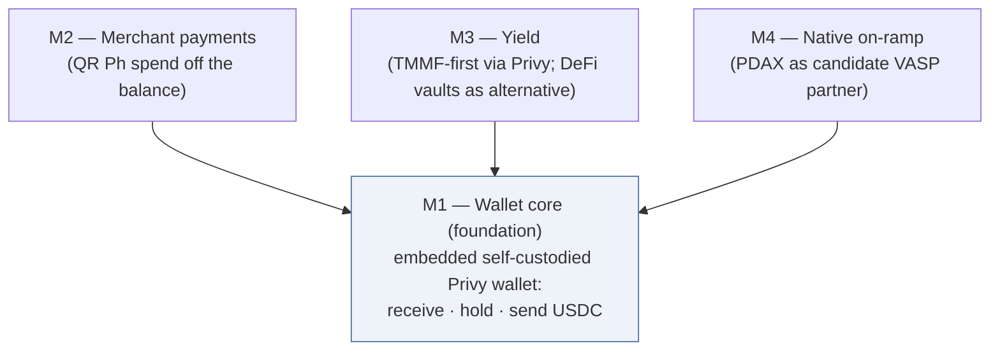

# Zed Dollar Wallet — Modular PRD (wallet-first)

**Status:** Draft v0.2 (2026-11-12) — settled facts only; decisions marked `OPEN` are for joint resolution (none silently assumed). Standalone product proposal.
**Surfaces:** repo canonical: this file; collaborative working copy: Claude Doc; team copies: Word files in Drive under Shared drives/Product/USDC Accounts (refreshed on meaningful revisions). Team copies carry no internal-workflow language.
**IDs:** decisions `W-D*`, requirements `W-R*`, open questions `W-Q*`. Items carried from the USDC Dollar Wallet PRD (v0.3, now superseded) cite their old `C-D*`/`C-R*` IDs for provenance; Privy confirmations keep their shared `C-PR*`/`C-Q*` IDs (canonical in the counterparty tracker).

**Changelog v0.2 (2026-11-12):** processed the USDC/USDT Philippine regulatory research handoff (11/12, `research/usdc-usdt-ph-regulatory-handoff.md`) into §5.0 as the working regulatory frame — **context only, not definitive** (it is a research handoff, not a legal opinion; the W-Q3/W-Q4 counsel gates stay authoritative). Enriched W-Q3/W-Q4; adopted the handoff's §6 diligence checklist as the counsel fact package; logged two instruments new to this project: BSP M-2026-023 (per-token listing diligence) and the BSP M-2026-003 question over steering users to external on-ramps under W-D6. Also processed the BSP-VASP DeFi-pooling analysis (inbox 11/09; uncited — corroboration only) into §5.0, and added the layered defensibility working position (M1 double inoculation; M3 integration spectrum and the curation/compensation dials) to §5.0 for counsel pressure-testing.
**Changelog v0.1 (2026-11-12):** initial draft. Trigger: the BSP's partial suspension of Coins.ph (Monetary Board Resolution No. 839, 2026-09-29 — inbound InstaPay/PESONet blocked for DCPay; still in force; license risk reported; details in the project bibliography). Direction (Steve, 11/12): invert the architecture — build the embedded self-custodied wallet first with bring-your-own funding, then bolt on independent modules (merchant payments via QR Ph; yield, tokenized-money-market-fund-first; an on-ramp via a different VASP partner, PDAX as the candidate). Supersedes the USDC Dollar Wallet PRD (Track C); carried components mapped in §2.

---

## 1. Summary

Zed offers Philippine customers a dollar-denominated account holding **USDC** in a **genuinely user-owned, self-custodied Privy wallet**, embedded as a tab in the existing Zed app. Unlike the previous architecture — which stood or fell with a single on-ramp partner — this product is built **wallet-first, in modules**: the wallet core ships without any money-movement partner at all (users fund it from wherever they already can), and merchant payments, yield, and a native on-ramp bolt on later, each as a product that can stand alone.

**Why the pivot:** the previous architecture routed its entire deposit leg through Coins.ph's inbound InstaPay/PESONet rails — exactly the capability the Bangko Sentral ng Pilipinas (BSP) suspended on 2026-09-29, with reinstatement timing unknown and the alleged abuse pattern (third parties settling with offshore-gaming operators in stablecoins) uncomfortably close in shape to a merchant pass-through on-ramp. The lesson is structural, not tactical: **no single counterparty should be able to take the whole product down.** The wallet core requires no licensed money-movement partner; every module that does require one is isolated, swappable, and optional.

### 1.1 The module map

| Module | One-line product | Stands alone as | Needs a licensed money-movement partner? |
|---|---|---|---|
| **M1 — Wallet core** | An embedded, self-custodied USDC wallet: your own address to receive, hold, send | A dollar store-of-value for anyone who can already acquire USDC | **No** — pure wallet software; funding is bring-your-own on-ramp |
| **M2 — Merchant payments** | Pay any QR Ph merchant from the USDC balance | "Spend dollars anywhere QR Ph works" | Yes — a conversion + settlement partner (the module's defining open question, W-Q1) |
| **M3 — Yield** | Opt-in yield on held USDC — tokenized money market funds (TMMFs) first, decentralized-finance (DeFi) lending vaults as the alternative | A dollar savings product | No money-movement partner; instrument/venue gates instead (SRC §8 for TMMFs — carried, design-blocking) |
| **M4 — Native on-ramp** | PHP in → USDC lands in the user's wallet | The convenience layer that completes the loop | Yes — a VASP partner; **PDAX** (Philippine Digital Asset Exchange) is the candidate; the Track C integration + ledger designs are the reusable template |

**Build order:** M1 first — it is the only hard prerequisite; everything else bolts onto it. M2, M3, M4 are mutually independent and sequence by opportunity (current lean: M2, then M3 with TMMF-first, then M4). Priority and pilot scope per module → W-D8.

**Positioning (carried):** "preserve wealth" over "grow savings" (peso-depreciation framing); never present yield in isolation; design for the stablecoin-literacy gap. The M1-only product targets users who can already self-fund — crypto-aware early adopters among the existing cardholder base — and that cohort choice is a feature: it validates custody UX and demand before any partner dependency exists.

## 2. What carries over from the USDC Dollar Wallet PRD (v0.3, superseded)

| Old item | Disposition here |
|---|---|
| C-D3 custody (user-owned self-custodied Privy wallet; no Zed signer/keys; open-loop; all outbound user-signed) | **Carried whole → W-D2.** The foundation of M1 |
| C-D2 stablecoin = USDC | **Carried → W-D3** (Privy Earn USDC vaults; Circle issuer posture; re-examined only if an M-level partner forces it) |
| C-D7 surface (tab in the existing Zed app; mobile-web POC; React Native/Flutter fallback) | **Carried → W-D4**, including the Andy POC and session-token carry-over |
| C-D11 yield opt-in · C-R9–C-R12 (user-signed vault ops, no pooling, fee-share dual control, honest yield display) · C-R13 PH availability in writing | **Carried whole → M3** (W-R group) |
| §4 TMMF side-option + SRC §8 design-blocking gate | **Promoted: TMMF is M3's primary instrument** (W-D5); the SRC §8 counsel question moves onto the critical path |
| C-D14 two-step deposit, C-D17 stale-balance policy, C-R4a/4b unconverted-PHP position, C-R7a PHP subledger + ledger design doc, C-D18 KYC review-and-edit screen, C-R1a field mapping | **Parked → M4 template.** All of it was Coins.ph-shaped but partner-generic: the two-step deposit UX, the interface-not-holder custody discipline, the suspense-account ledger, and the KYC pass-through pattern restate against PDAX when M4 is scoped |
| C-R17 card-account-state independence (delinquent: wallet stays accessible; closed: access preserved; documents area) | **Carried → W-R5** — more important now, since M1 is pure software with no partner excuse for lockouts |
| C-R16 runbooks, C-R14 counsel-gates pattern | **Carried, re-scoped per module** (§5) |
| Coins.ph integration doc, OQ-1..16 | **Parked as reference.** Not deleted — the best map of what a VASP-partner integration needs, and the question set to re-ask PDAX |
| C-D9 naming, positioning principles, terminology discipline | **Carried** (naming still open → W-D9) |

## 3. Decisions

### 3.1 Settled

| # | Decision | Choice | Basis |
|---|---|---|---|
| W-D1 | Strategy | **Wallet-first, modular** (Steve, 11/12): M1 ships with bring-your-own funding; M2/M3/M4 are isolated bolt-ons, each viable alone | BSP suspension of Coins.ph inbound rails demonstrated the single-partner failure mode |
| W-D2 | Custody | User-owned, self-custodied Privy wallet; no Zed signer or keys; open-loop; all outbound user-signed | Carried C-D3; Privy config confirmations C-PR-1..5 still apply |
| W-D3 | Stablecoin | USDC | Carried C-D2 |
| W-D4 | Surface | Tab in the existing Zed app, loading a mobile-responsive web app (POC validation; React Native/Flutter fallback) | Carried C-D7 (settled 9/24) |
| W-D5 | M3 instrument order | **TMMF first**, DeFi lending vaults (Aave-family via Privy) as the alternative — inverts the old C-D5 lean | Steve, 11/12; easier regulator story, countercyclical, Treasury-backed; subject to the SRC §8 gate |
| W-D6 | M1 funding model | **Bring-your-own on-ramp**: the user funds their own address from any external source; Zed builds no deposit rail into M1 | Steve, 11/12 — the de-risking core of the strategy |

### 3.2 OPEN

| # | Decision | The question | Preliminary note |
|---|---|---|---|
| W-D7 | M2 settlement partner | Who converts USDC→PHP and settles QR Ph merchant payments (see W-Q1) | Partner scan not started |
| W-D8 | Module sequencing + pilot scope per module | Current lean M2 → M3 → M4; cohort + caps per module undecided | Old C-D15 (50 invite-only cardholders) is a reference point for M1 |
| W-D9 | Naming / brand | Working name stays "Dollar Wallet" | Carried C-D9 |
| W-D10 | Chain | Lean: Base (Privy Earn USDC vaults live there) — but now gated on M3 instrument availability and M2/M4 partner rails, not on Coins.ph | Carried C-D16, re-based |
| W-D11 | M1 receive guardrails | How open is "open-loop receive": any sender vs. screening/limits; multi-chain receive vs. single-chain with guidance | Interacts with W-Q3 (counsel) |

## 4. Module requirements

Each module: the flow to build first, then requirements as capability statements with implementation detail nested beneath.

### M1 — Wallet core (the foundation)

**The flow to build:** an existing Zed cardholder activates the Dollar Wallet tab; their self-custodied Privy wallet is created (user-sole-owner, keyed to Zed's existing auth via JSON Web Token / OpenID Connect bring-your-own-auth — no re-registration); they see their **receive address** with clear chain guidance and can share/copy it; funds they send from an exchange or another wallet appear as their USDC balance; they can **send** USDC to any address by signing the transaction themselves; everything keeps working regardless of their card-account state.

- **W-R1. Wallet creation** (carried C-R9 config): user-sole-owner Privy wallet; no Zed key material; export/recovery usable independently of Zed (C-PR-3); creation idempotent and invisible-fast inside the tab.
- **W-R2. Receive.** The address is first-class UX: copy/share/QR render, explicit chain labeling ("send only USDC on {chain}"), deposit detection with confirmation states, and a designed answer for wrong-asset/wrong-chain sends (recovery guidance, not silence). Chain scope per W-D10/W-D11.
- **W-R3. Send.** User-signed, open-loop to any address; fee (gas) handling defined (sponsored vs. user-paid → gas strategy from the Privy tech digest); address-book and safety affordances (test-send nudge, allowlist option).
- **W-R4. Balance truth.** The chain is the source of truth; no Zed ledger of user balances (carried C-R7 principle). Display = on-chain balance + pending in/outbound states.
- **W-R5. Card-account-state independence** (carried C-R17): delinquency locks the card tab, never the wallet; closed card accounts retain wallet access (empty/marketing-state pattern); forced-offboarding path designed without a partner to force it through.
- **W-R6. Compliance posture** (→ W-Q3): Zed provides self-custody wallet software; it is not custodian, exchange, or transmitter. Product must preserve that: no pooling, no Zed-controlled flow of user funds, terminology discipline. Sanctions/screening posture on receive and send per counsel.
- **W-R7. Runbooks** (carried C-R16 pattern): Privy outage, chain congestion, compromised-device support flow, pilot halt (which, with no partner, is just feature-flagging the tab).

### M2 — Merchant payments (QR Ph)

**The flow to build:** the user scans any QR Ph code (the Philippines' national QR payment standard); the app shows the merchant and the PHP amount, quotes the USDC debit at that moment's rate (rate-at-moment disclosure, carried from C-D14's spirit), the user confirms with their signature, and the merchant is paid PHP over QR Ph rails while the USDC leaves the user's wallet.

- **W-R8. The settlement leg is a partner capability** (→ W-Q1, the module's defining question): a licensed counterparty performs USDC→PHP conversion and QR Ph (InstaPay person-to-merchant) payout. Zed remains interface, never holder — the Track C position discipline (C-R4b pattern) restates against whoever this partner is.
- **W-R9. Rate + total-cost disclosure** at confirmation; no spread opacity.
- **W-R10. Per-payment traceability** (carried C-R4 pattern): QR payload, quote, rate, USDC debit tx hash, PHP settlement reference — reconcilable end to end.
- Kept deliberately thin until W-Q1 has candidates; note Coins.ph's *outbound* rails were never suspended — but building the spend leg on a partner under active BSP remediation is not the plan (W-Q1 scan includes PDAX, EMIs/acquirers, and stablecoin-settlement providers).

### M3 — Yield

**The flow to build:** a separate, opt-in surface under its own terms (carried C-D11/C-R3 pattern): the user moves USDC from their wallet into the yield instrument by signing themselves, watches the position, withdraws anytime by signing again. **Instrument order: TMMF first** (W-D5), reachable through the same Privy integration; DeFi lending vaults (Aave-family) as the fallback if the TMMF gate fails.

- **W-R11. The SRC §8 gate comes before design** (carried, now critical path): a tokenized money market fund offered to Philippine retail plausibly requires securities registration under the Securities Regulation Code §8 — counsel opinion **before** the yield flow is designed. Working frame (§5.0, non-definitive): the complete customer arrangement is what gets classified — neither the partner intermediation nor self-custody resolves it on its own. If it fails: the DeFi-vault alternative proceeds under the old C-Q12 characterization question instead; the lending explainer + venue-decision doc carries.
- **W-R12–15. Custody + display invariants** (carried C-R9–C-R12 whole): user-signed instrument entry/exit, positions self-custodied where the instrument allows, no Zed pooling or omnibus position; Zed's fee share to the dedicated admin wallet under key-quorum dual control; yield shown as variable, never "interest," loss-possible and liquidity disclosures, never yield in isolation.
- **W-R16. Gates before external users:** Philippine availability of the chosen Privy instrument **in writing** (C-Q6 pattern — now asked per instrument, TMMF availability/eligibility first); instrument diligence memo (carried C-R15).

### M4 — Native on-ramp (later)

**The shape:** PHP in → USDC delivered to the user's own wallet, via a VASP partner. **PDAX is the candidate** to scope. The Track C corpus is the template: the integration question set (OQ-1..16 re-asked), the two-step deposit UX (C-D14), the interface-not-holder custody discipline (C-R4a/4b), the KYC pass-through + review-and-edit screen (C-R1a/C-D18), and the PHP ledger design (suspense account and all) restate against PDAX's actual API surface.

- **W-R17. Partner-independence invariant:** M4 (and M2) integrations are bounded modules behind interfaces, so a partner suspension disables a module, never the product. This is the W-D1 strategy expressed as an engineering requirement.
- Scoping questions → W-Q2 (PDAX capabilities: collection/virtual accounts? direct-to-external-wallet delivery? merchant KYC pass-through? InstaPay inbound?); relationship intro first.

## 5. Status board

### 5.0 Regulatory working frame — context, not conclusions

From the 11/12 research handoff (`research/usdc-usdt-ph-regulatory-handoff.md`; primary sources cited there). **Nothing in this subsection is treated as definitive** — it is not a legal opinion; it frames what counsel must answer under W-Q3/W-Q4. The load-bearing points:

- **Three separate analyses, never one:** the token itself; the complete customer-facing arrangement; and each provider's regulated activities. A non-security conclusion on plain USDC decides nothing about a yield feature built on it.
- **M1's posture is the strongest case:** plain holding and transfer with no promised return carries the strongest non-security argument (the instrument "is not a security in the first place," per the investment-contract test in *Power Homes v. SEC*) — but it still requires an operating-model review (which entity performs exchange, transfer, or safekeeping under BSP Circular 1108), and no published SEC determination blanket-resolves USDC or USDT as non-securities.
- **Yield changes the question — and neither partnering nor self-custody changes the answer:** committing tokens to a return-generating arrangement may create a separate regulated instrument; "moving the promise to a third-party partner" does not resolve classification, and the handoff's scenario matrix flags exactly M3's shape ("self-custody wallet with integrated access to an offshore yield service") as leaving promotion, intermediation, and investment-rights questions open.
- **Bring-your-own funding (W-D6) has its own wrinkle:** BSP M-2026-003 states PH-resident retail may not directly access unregistered offshore VASPs (it is addressed to BSP-supervised institutions — the handoff cautions against reading it as making token ownership unlawful). If Zed's UX steers users toward specific external on-ramps, that Zed-linked arrangement needs explicit review → folded into W-Q3.
- **Per-token diligence is its own obligation:** BSP M-2026-023 (June 2026) requires token- and network-level listing diligence (reserves, redemption, liquidity, legal rights) with ongoing monitoring and delisting triggers — the diligence pattern partners and counsel will expect even where Zed itself is not a VASP (feeds W-D3/W-D10).
- **Standing regardless of classification:** the VASP-license moratorium continues (BSP M-2025-031 — constrains any own-license path and frames partner scarcity for M4); the Financial Products and Services Consumer Protection Act (RA 11765) disclosure duties align with the W-R12–15 display rules (never imply an insured deposit; distinguish token value from investment return; substantiate any guarantee claim).
- **Why local VASPs don't offer DeFi pooling (corroboration only — uncited analysis):** a separate research note (`research/bsp-vasp-defi-pooling.md`) argues BSP Circular 1108's custody/safekeeping mandate, outsourcing-control rules, and the ₱50,000 FATF travel-rule threshold make VASP-pooled DeFi exposure unworkable, pushing yield products toward the SEC's perimeter. Consistent with M3's design (the user enters any instrument themselves, self-custodied and user-signed — no VASP or Zed pooling) and with treating classification as W-Q4's question — but it carries no citations, so it corroborates the frame rather than establishing it.

The handoff's diligence checklist — customer entitlement, asset control, return source and calculation, operating roles, customer journey, funds flow — is adopted as **the fact package to assemble for counsel** under W-Q3/W-Q4.

**Working position — the layered defensibility argument** *(set 11/12; for counsel to pressure-test under W-Q3/W-Q4, not a settled conclusion)*:

1. **M1 is inoculated twice, by two different features.** Self-custody defeats the activity-based regimes (no exchange, transfer, or custody of others' assets — Zed ships software) and prevents any Zed-layer instrument from arising (a self-custodied token creates no claim on Zed that could be recharacterized as debt, a participation interest, or e-money). Bring-your-own funding defeats the offering question (Zed never offers, sells, or delivers USDC — users acquire it elsewhere). Residuals for W-Q3: whether constructing transactions for the user's signature could be read as "transfer on behalf of another"; the characterization of Privy's key-share infrastructure; and whether in-app promotion of holding USDC is MC 4 §7 marketing even absent any sale.
2. **Each later module deliberately re-accepts one named exposure.** M4 reintroduces offer/sale of the token (the partner sells; Zed markets the flow). M3 creates a new customer arrangement to classify. The modular build order is also a legal sequencing: the clean core ships first.
3. **M3's structure takes the worst theories off the table.** No custody, no pooling, no discretion, no Zed-issued receipt or claim; entry and exit are user-signed from the user's own wallet. That defeats "Zed operates an investment pool" and "Zed issued its own yield instrument" — the fatal outcomes. For raw protocol supply (Aave-style) there is additionally an argument that no security exists at all; note the asymmetry: a curated vault's curator reintroduces "efforts of others," and a tokenized money market fund share is a security on its own terms — so the no-security escape is instrument-dependent, and unavailable for the first-choice instrument (which is why SRC §8 sits design-blocking in front of it).
4. **What user-signed execution does not defeat: solicitation.** "Offer, sell, distribute, market" turns on who presented the opportunity, induced the decision, and was compensated — not on who signed the transaction. An integrated yield tab presenting one pre-selected instrument with a fee share to Zed is the strongest product and the thinnest form of the self-directed argument. The integration spectrum, strongest legal posture first: (a) the user exports their wallet and reaches a protocol's own frontend — outside Zed's perimeter entirely (the true content of "self-custody inoculates"); (b) education only, no in-app entry point; (c) links or a directory, no compensation; (d) the current design — integrated single-instrument flow with a fee share. **The two dials counsel must price: curation/presentation, and compensation.**
5. **PH VASPs' absence from DeFi access corroborates the structure, not the risk.** A custodial platform's version is worst-case by construction: supplying a pool breaches the Circular 1108 safekeeping mandate, constitutes investment management outside the money-service-business perimeter, converts the customer's claim into the VASP's own unregistered arrangement, and fails the outsourcing-recourse and travel-rule-beneficiary requirements. The clean version of the trade exists only in a non-custodial architecture — structural precedent: Robinhood Earn's self-custodial Morpho supply. Cautions: the licensed incumbents' unanimous abstention also reads as regulator temperature, untested waters are not safe waters, and the promotion half of their problem remains ours in miniature.
6. **The question for counsel is therefore not "does self-custody make this permissible."** It is: given no custody, no pooling, no discretion, and no Zed instrument, what combination of curation, presentation, and compensation keeps the integrated flow on the right side of offer, solicitation, and marketing — and what product features would we trade to stay there?

### 5.1 Open questions

| ID | Question | Blocks | Status |
|---|---|---|---|
| W-Q1 | M2 settlement partner: who can do USDC→PHP + QR Ph person-to-merchant payout for an embedded wallet, under what license posture | M2 | Open — scan not started |
| W-Q2 | PDAX capability + appetite scan (re-ask the Track C OQ set) | M4 | Open — needs relationship intro |
| W-Q3 | Counsel: characterization of M1 — self-custody wallet software provided by a PH-facing app: any VASP/EMI/money-transmission trigger? Screening obligations on open-loop receive/send? Travel-rule exposure on sends? Plus (§5.0): does UX that steers users to specific external on-ramps create a reviewable Zed-linked arrangement under BSP M-2026-003? Fact package = the §5.0 diligence checklist | M1 external launch | Open — new question, not in the Track C set |
| W-Q4 | Counsel: TMMF / SRC §8 (carried C-Q14). Frame per §5.0: the complete arrangement is what gets classified — neither Privy’s intermediation nor self-custody resolves it | M3 design start | Open — **critical path now** |
| W-Q5 | Privy: TMMF instrument availability + PH eligibility in writing (C-Q6 pattern, per instrument) | M3 | Open |
| W-Q6 | Coins.ph relationship: suspension status, reinstatement timeline, their account of the cause — keeps M4 optionality honest | M4 optionality | Open — relationship-level, not API-level |

### 5.2 Carried partner items (canonical in the shared counterparty tracker)

C-PR-1..5 (user-sole-owner config, no Zed signer, export/recovery, open-loop sends) — now gate **M1**, not a future module; sandbox verification is the next concrete engineering step. Privy Earn/TMMF items gate M3.

### 5.3 Next steps

1. M1 build kickoff: Privy sandbox verification of C-PR-1..5 under Zed's config; wallet-core tech design (bounded module per W-R17); continue the Andy mobile-web POC (carried).
2. Counsel asks, in parallel: W-Q3 (M1 characterization — needed before external users) and W-Q4 (SRC §8 — needed before M3 design).
3. Privy: TMMF availability + PH eligibility in writing (W-Q5).
4. W-Q1 partner scan for the QR Ph settlement leg.
5. PDAX introduction (W-Q2); hold W-Q6 (Coins.ph status) warm.
6. Pilot definition for M1-only (W-D8): cohort, caps, success metrics for a bring-your-own-funding wallet.

## 6. Document map

| Document | What it holds | Where |
|---|---|---|
| **This PRD** | The modular strategy, decisions, module requirements, status board | Repo: `tracks/d-wallet-first/prd.md` · team copy: Drive → Shared drives/Product/USDC Accounts |
| USDC Dollar Wallet PRD (v0.3, superseded) | The Track C record; source of everything in §2 | `../c-usdc-vasp-privy/prd.md` |
| Coins.ph integration doc | Parked reference; the question template for any VASP partner (M4) | `../c-usdc-vasp-privy/research/coinsph-integration.md` |
| PHP ledger design | Parked M4 template (suspense-account mirror, cash-in/conversion/cash-out postings) | `../c-usdc-vasp-privy/research/php-ledger-design.md` |
| Privy Earn + platform digests | M1/M3 mechanics: custody statements, wallet actions, Earn, gas, quorums | `../c-usdc-vasp-privy/research/privy-earn.md`, `privy-tech-docs.md` |
| Onchain lending explainer & yield-venue decision | M3's DeFi-alternative analysis | Claude Doc (shared separately) |
| Counterparty & counsel tracker | Shared confirmation tracker (Privy items canonical) | `../../counterparty-counsel-tracker.md` |
| Source bibliography | Every processed source incl. the BSP-suspension reporting | `../../SOURCES.md` |
